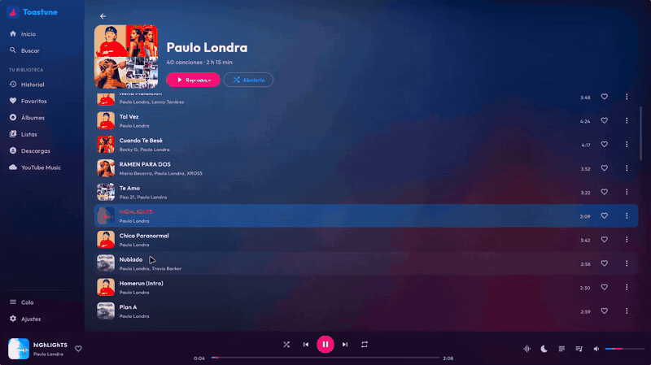
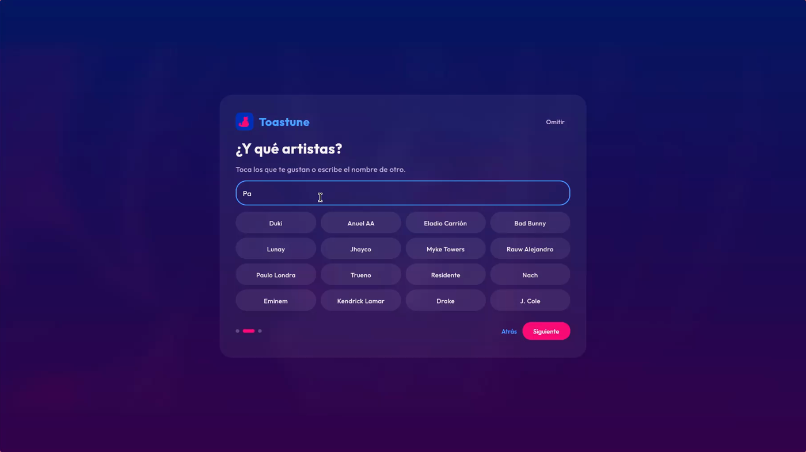
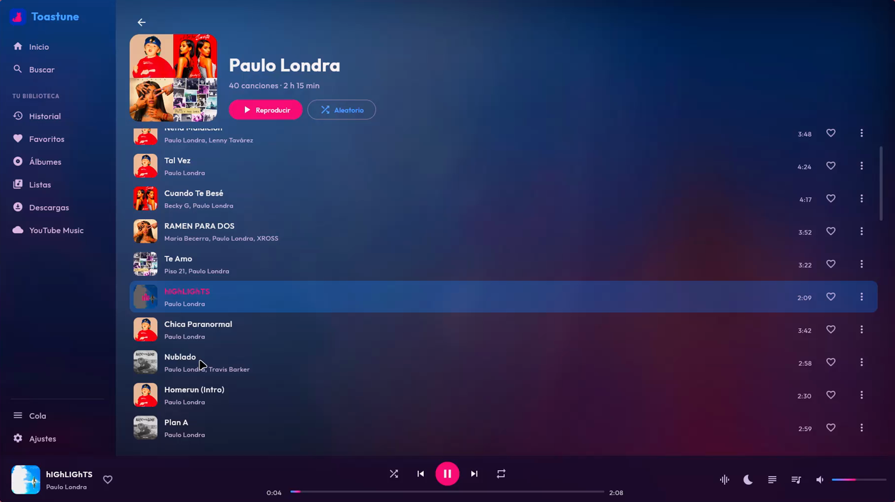
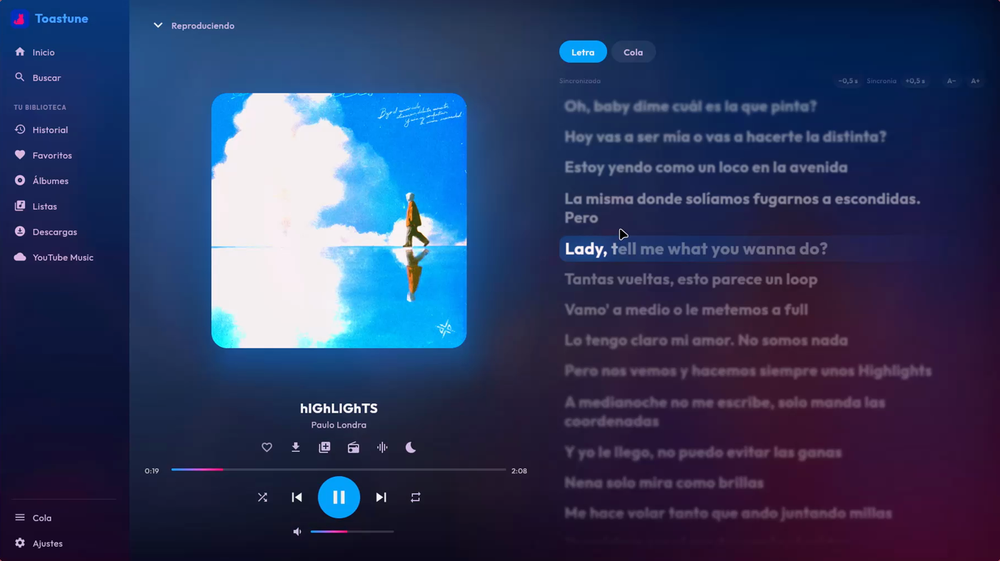
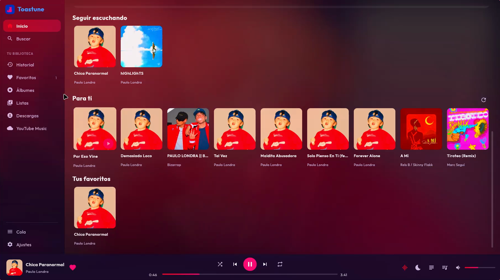
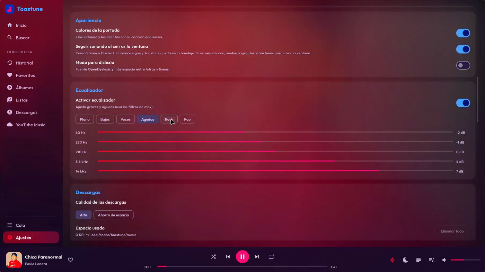

# Toastune 🐾

Mira más proyectos en el [portafolio](https://portafolio-rho-snowy.vercel.app/).

Reproductor de música gratuito y de código abierto, nombrado por Tostada, una gatita muy querida.
Busca y reproduce desde YouTube Music, con letras sincronizadas, descargas sin conexión,
listas, mezcla entre canciones y sincronización de tu biblioteca.

## Capturas (Linux)

| | |
|---|---|
|  |  |
|  |  |
|  | |

## Versiones

| Carpeta | Plataforma | Tecnología |
|---|---|---|
| [`Toastune (Android)`](Toastune%20(Android)) | Android | Kotlin, Jetpack Compose, Media3 |
| [`Toastune (Linux)`](Toastune%20(Linux)) | Linux (escritorio) | Kotlin, Compose Desktop, mpv, MPRIS |

Cada carpeta es un proyecto Gradle completo e independiente. Mira el `README.md` de cada
una para compilarla y probarla; la de Linux tiene además `docs/LINUX.md` con la instalación.

## Características

- Búsqueda y reproducción (YouTube Music), cola editable, aleatorio y temporizador de sueño
- Favoritos, historial y playlists locales; copia de seguridad en JSON
- Descargas y caché sin conexión
- Letras sincronizadas (LRCLIB)
- Inicio de sesión con YouTube Music y sincronización con Google Drive
- Linux: integración con el escritorio (MPRIS, bandeja), mezcla entre canciones y reproducción sin pausas

## Aviso

Proyecto no afiliado a Google ni a YouTube.

## Licencia

[GPL-3.0](LICENSE), porque usa [NewPipeExtractor](https://github.com/TeamNewPipe/NewPipeExtractor) (GPL-3.0).
